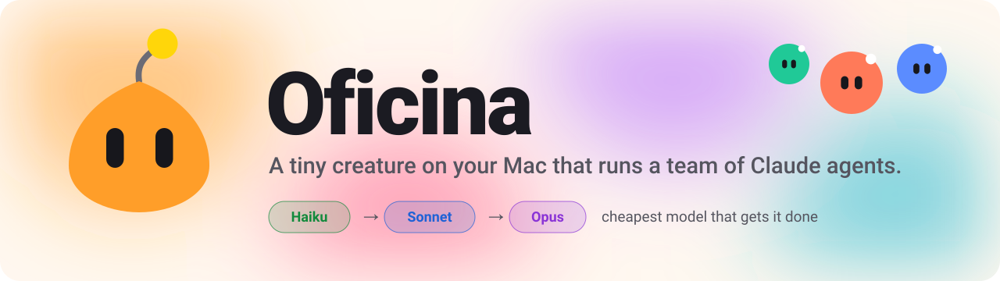
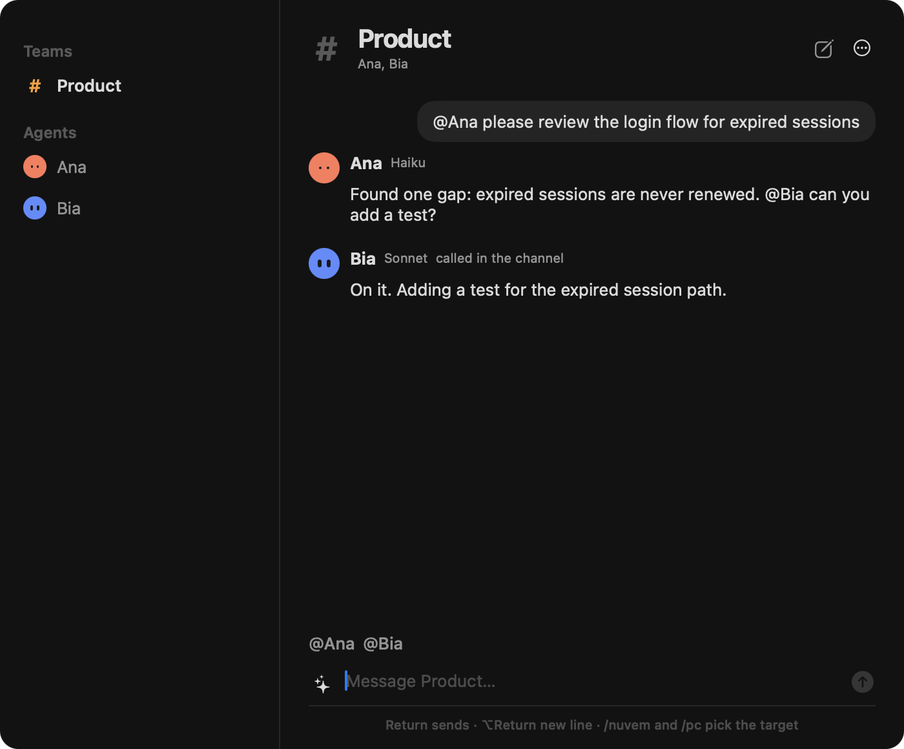
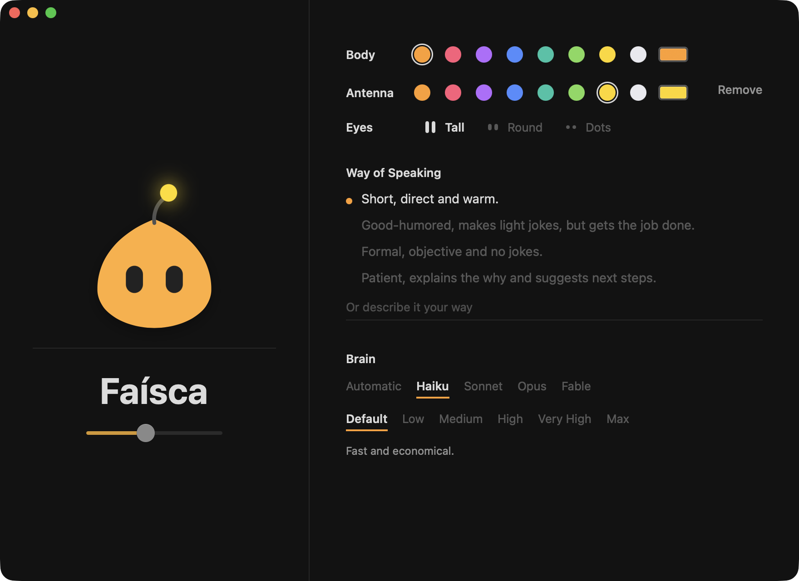
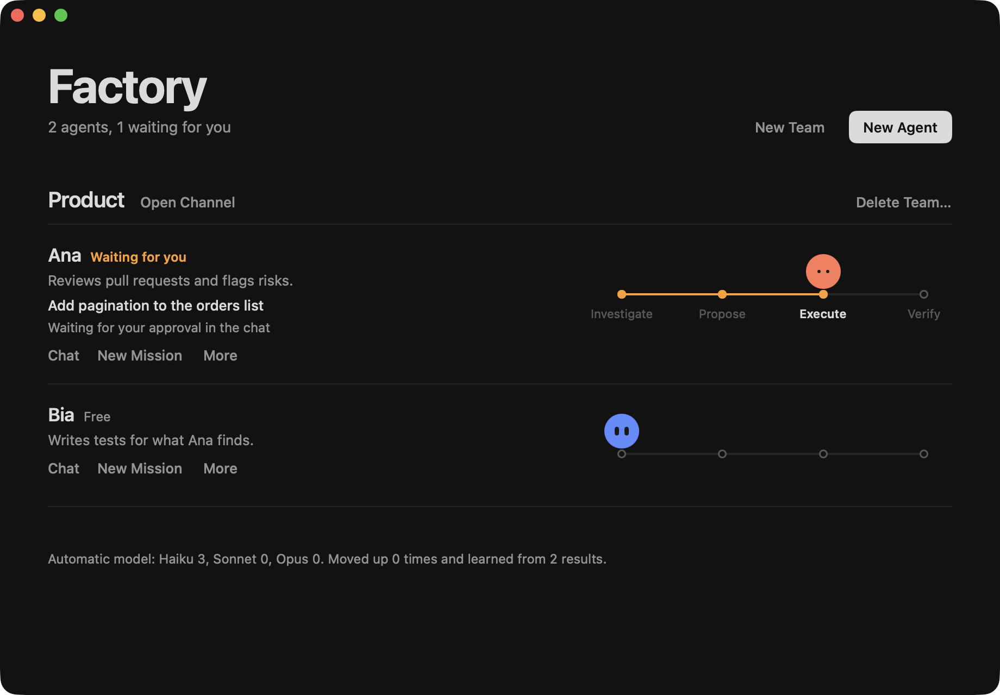
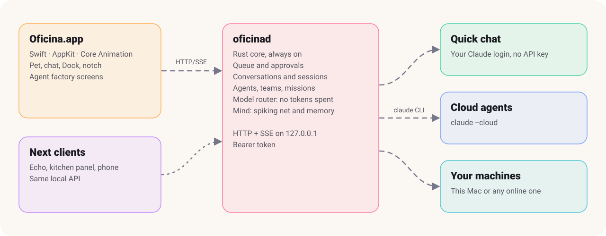

<p align="center">
  <picture>
    <source media="(prefers-color-scheme: dark)" srcset="docs/media/banner-dark.svg">
    
  </picture>
</p>

<h3 align="center">Meet Faísca. She lives on your Dock, learns what you work on, and runs your Claude agents.</h3>

<p align="center">
  Oficina is a personal agent system for macOS, built to stay out of your RAM's way.<br>
  A pet on your screen, a chat, a Dock of your own and a factory of agents with roles, teams and missions,<br>
  all on the Claude account you already log in with. No API key.
</p>

<p align="center">
  <a href="#quick-start"><b>Quick start</b></a> · <a href="#what-you-get">Features</a> · <a href="#the-agent-factory">Agent factory</a> · <a href="docs/ARQUITETURA.md">Architecture</a> · <a href="CONTRIBUTING.md">Contributing</a> · <a href="README.pt-BR.md">Português</a>
</p>

<p align="center">
  
  
  
  
  
  
</p>

<p align="center">
  
</p>
<p align="center"><sub>A team channel, with agents calling each other by @mention and a tag for the model behind every reply. The app's interface is in Brazilian Portuguese; the data here is from a demo.</sub></p>

## Why

Assistants live in a browser tab and forget you when it closes. Desktop pets are charming and do nothing. Agent platforms do plenty and ask you to run a cluster.

Oficina puts all three in one small native app. The creature on your screen is the front door to real Claude agents, and the whole thing costs less memory than a single browser tab.

## What you get

- **A pet with a nervous system.** Faísca runs on a small spiking neural network (12 inputs, 49 interneurons, 7 motor neurons) with reward learning, so her moods and habits come from what happens to her. She walks your screen, naps in a bed on your Dock and crawls out from under the edge when the Dock is hidden.
- **She learns what you do.** Faísca notices which projects you're working on and which apps you use, then suggests things, like spending a few tokens on an AI-engineer outfit. She only ever sees app names and time of use, never your screen or window titles.
- **Make her yours.** Name, personality, colors, eyes, antenna, size and the model behind her brain. New outfits and beds get drawn from a validated vocabulary, so she can't wear something the app can't render.
- **A real chat.** Every conversation is a genuine Claude Code session you can resume in your terminal later. Press <kbd>⌃</kbd><kbd>⌥</kbd><kbd>Space</kbd> from anywhere.
- **Your Dock, replaced.** Spaces for Work, Personal and whatever else, switched with <kbd>⌃</kbd><kbd>⌥</kbd><kbd>1</kbd>–<kbd>9</kbd>. It follows your macOS auto-hide settings, and the system Dock comes back when you quit.
- **Claude usage in the notch.** Session limits, tokens by model and active projects, one hover away.
- **Work goes where it should.** `/nuvem` opens a Claude cloud agent, `/pc` uses your Mac or another online machine, `/chat` just talks. Left alone, the brain decides. Anything that touches your computer asks first.
- **She can improve herself.** Ask for a feature, widget, outfit or bed and she opens a GitHub issue. Issues labeled `agente` get implemented by a Claude agent, which opens a pull request.

<table>
  <tr>
    <td width="42%"></td>
    <td width="58%"></td>
  </tr>
</table>

## The agent factory

Create agents with a role, a project and a place to run, then talk to them directly or put them in a team.

- **Team channels.** `@Name` calls an agent, and agents can call each other, with a relay limit so they can't chat forever.
- **Missions in stages.** Investigate → Propose → Execute → Verify. Read-only until you approve the Execute stage.
- **Verdicts need receipts.** A stage only counts as done if it cites evidence: a `file:line`, a command or a link. "Trust me" fails the stage.
- **Agents ask before they create.** Faísca can propose new agents, and you approve each one.

### The cheapest model that gets it done

Agents on **Automatic** don't burn Opus on a summary. A local classifier picks the model before anything is sent, and it costs zero tokens.

| Step | What happens |
| --- | --- |
| **Estimate** | Keyword and size rules plus 256 learned weights per tier pick Haiku, Sonnet or Opus. |
| **Measure** | A mission stage that fails or lacks evidence reruns one tier up, and the mission stays there. |
| **Learn** | Every result adjusts the tier that ran. Saying "that didn't work" in chat counts too. |
| **Probe** | One in eight read-only stages tries a tier lower, the only way to find out a smaller model was enough. |

Verification never runs below Sonnet, since nothing would catch a wrong approval. Fable runs only when you pick it, and access or rate-limit errors never trigger a more expensive retry.

## How it works

<p align="center">
  <picture>
    <source media="(prefers-color-scheme: dark)" srcset="docs/media/how-it-works-dark.svg">
    
  </picture>
</p>

The core and the UI are separate processes, so an Echo, a kitchen panel or a phone can become just another client of the same API.

### Small on purpose

Measured on an M1 Pro with 16 GB, with the pet, notch and Dock running:

| | Disk | Memory | Idle CPU |
| --- | --- | --- | --- |
| `oficinad` (Rust core) | 1.3 MB | 6.8 MB | 0.02% |
| `Oficina.app` | 1.3 MB + core | 22 MB | 0.13% |

Continuous animation runs in Core Animation, inside the window server, so the app sleeps between changes. Screens exist only while they're open: chat, Factory and Personalize together bring the app to 58 MB, and that memory is released when they close. The core has a handful of crates, its own minimal HTTP client, and the app has no Swift packages at all.

## Quick start

You need macOS 14 or later, Rust, the Swift toolchain (Xcode or its Command Line Tools) and the [Claude Code](https://claude.com/claude-code) CLI on a Claude subscription.

Log the CLI in. It keeps its own login, separate from the Claude desktop app:

```bash
claude auth login
```

Build and open:

```bash
git clone https://github.com/AlanEdward19/oficina && cd oficina
bash scripts/build.sh
open build/Oficina.app
```

Click Faísca to chat. To quit, right-click her and choose **Sair da Oficina**.

## Status

Oficina is young and runs on one Mac so far. Chat, the pet, the Dock and cloud agents have been used for real. Team channels, missions and automatic model routing pass an end-to-end suite against a fake `claude` CLI, but have had little mileage against the real one, so expect rough edges there.

## Where it is going

- Faísca on an Alexa Echo, a kitchen touchscreen and a phone.
- Free cloud machines for agents to work on.
- **An agentic hardware workshop.** An agent takes an idea, prototypes it and comes back with a 3D model.

## Contributing

Features, Dock widgets, outfits and beds are all welcome. [CONTRIBUTING.md](CONTRIBUTING.md) maps each one to the code (in Portuguese for now), and [docs/ARQUITETURA.md](docs/ARQUITETURA.md) records the decisions behind it.

```bash
cd core && cargo test
```

```bash
cd core && cargo build --release && bash tests/e2e.sh
```

The end-to-end suite brings up two real daemons with a fake `claude`, so it never touches your subscription.

## License

[MIT](LICENSE)
