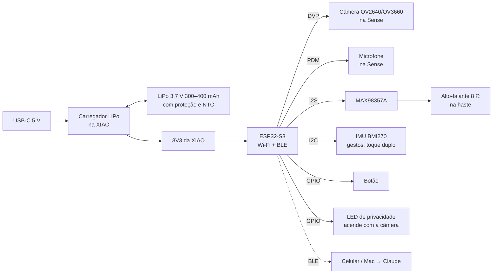

# Estudo: a Oficina de hardware (modelador 3D)

Status: proposta. É o item 6 do [Caminho](../ARQUITETURA.md#caminho): ideia → pesquisa → protótipo → modelo 3D.

Exemplo do estudo inteiro: **"quero fazer um óculos com IA embutida, tipo os da Meta."**

## O que a pessoa recebe

Um **pacote do projeto**, uma pasta em `~/Oficina/hardware/<projeto>/` que a tela nova mostra em abas:

| Aba | Conteúdo | Arquivos |
|---|---|---|
| Requisitos | o que o produto faz, limites (peso, autonomia, preço) | `requisitos.md` |
| Pesquisa | produtos e projetos parecidos, o que copiar, o que evitar | `pesquisa.md` |
| Eletrônica | diagrama de blocos, mapa elétrico, esquemático | `eletrica/*.ato`, `.kicad_sch`, `.svg` |
| Peças | lista de materiais com preço, link e alternativa | `bom.csv` |
| Modelo 3D | carcaça e peças posicionadas, vista explodida | `mecanica/*.py`, `.step`, `.stl`, `.usdz` |
| Simulação | autonomia, calor, peso e equilíbrio, circuito, firmware | `simulacoes/*.md` + gráficos |
| Montagem | passo a passo com imagens da vista explodida | `montagem.md` |
| Firmware | código inicial que liga tudo | `firmware/` |

## Princípio: tudo é código

Modelos de linguagem erram geometria desenhada à mão, mas escrevem bem **código paramétrico**. Então cada peça
do pacote é texto que um agente gera e uma ferramenta confere:

| Parte | Ferramenta | Por quê |
|---|---|---|
| Mecânica | **build123d** (Python, Open CASCADE) | gera STEP e STL; medidas vêm de variáveis tiradas do datasheet |
| Esquemático | **atopile** (ou SKiDL) → KiCad | circuito em texto declarativo, compila para projeto KiCad; atopile tem MCP |
| Verificação elétrica | `kicad-cli` (ERC, exportar SVG/PDF) | prova que o esquema fecha |
| Circuito analógico | **ngspice** | carregador, reguladores, filtros de áudio |
| Firmware | **Renode** (aberto) ou Wokwi | roda o firmware do ESP32 sem placa |
| Esforço mecânico | FreeCAD FEM / CalculiX (opcional) | dobradiça, haste |
| Visual no app | SceneKit + ModelIO (já vêm no macOS) | abre USDZ, STL e OBJ sem dependência |

Geradores de malha a partir de texto (estilo Meshy) servem só para conceito visual: não têm medidas reais.

## Como a Fábrica faz isso

A Fábrica já tem agentes, equipes e missões (Investigar → Propor → Executar → Verificar). A Oficina de hardware
é uma **equipe pronta** com um modelo de missão:

| Agente | Papel | Etapa |
|---|---|---|
| Pesquisadora | requisitos, referências, componentes candidatos, datasheets | Investigar |
| Eletrônica | diagrama de blocos, consumo, esquemático, ERC | Propor / Executar |
| Mecânica | carcaça em build123d em volta das medidas reais das peças | Executar |
| Simulação | roda as simulações e diz o que não passou | Verificar |
| Montagem e compras | passo a passo, BOM com preços, alternativas | Executar |

Cada etapa termina com veredito e evidência, como já é a regra. Se a simulação reprova (bateria dura 1h e o
requisito pede 4h), a missão volta para Propor com o motivo. A pessoa aprova antes de cada etapa que gasta
muitos tokens e antes de qualquer compra.

### Ferramentas sem shell livre

Agentes no Mac não têm shell livre (`allowed_tools`). Em vez de abrir isso, o core ganha um subcomando restrito:

```
oficinad hw build   <projeto>   # build123d → STEP/STL/USDZ, checa interferência e peso
oficinad hw erc     <projeto>   # atopile → KiCad, ERC, exporta SVG
oficinad hw sim     <projeto> <bateria|termica|spice|firmware>
oficinad hw export  <projeto>   # gerbers, BOM, PDF de montagem
```

Só esse comando entra na lista de ferramentas do agente. As ferramentas (Python + build123d, atopile, KiCad,
ngspice) ficam num ambiente isolado em `~/Oficina/hardware/.env`, instalado na primeira vez com pergunta,
porque ocupa ~2 GB.

## O exemplo: óculos com IA

### Requisitos que a Pesquisadora fecharia com você

- Câmera para foto, microfone, alto-falante perto do ouvido, botão.
- IA pelo celular ou nuvem (Claude com visão), não no óculos.
- Autonomia de pelo menos 4h de uso misto; menos de 50 g; custo de protótipo abaixo de R$ 500.
- Opcional: tela pequena (HUD) num olho.

### Três caminhos

| | A. Sem tela (estilo Ray-Ban Meta) | B. Com HUD num olho | C. Computador no óculos |
|---|---|---|---|
| Cérebro | XIAO ESP32-S3 Sense | ESP32-S3 ou nRF5340 + micro-OLED | Linux (Pi Zero 2 W) |
| IA | celular / nuvem | celular / nuvem | parte local |
| Dificuldade | baixa, módulos prontos | alta, a ótica é o difícil | alta |
| Peso, calor | bom | médio | ruim |
| Recomendação | **v1** | v2, comprando o módulo ótico pronto | não |

Referências reais: o **OpenGlass** (BasedHardware, MIT) fez o caminho A com XIAO ESP32-S3 Sense, bateria de
250 mAh e suporte impresso em 3D por menos de US$ 25; o projeto seguiu no repositório Omi. Para o caminho B,
vale estudar os óculos abertos da Brilliant Labs (o agente confere o hardware atual antes de recomendar).

### Mapa elétrico do caminho A



A escolha da XIAO Sense é o que torna a v1 fácil: carregador, câmera e microfone já estão na placa, então a
v1 é **fiação de módulos, sem PCB**. A v2 troca por uma placa flexível própria dentro da haste.

### Peças (v1, valores de referência que o agente atualiza)

| Peça | Função | Observação |
|---|---|---|
| Seeed XIAO ESP32-S3 Sense | cérebro, câmera, microfone, carregador | 21 × 17,5 mm |
| LiPo 3,7 V 300–400 mAh com PCM | energia | célula fina para a haste; nunca sem proteção |
| MAX98357A | amplificador I2S | ou módulo pronto |
| Alto-falante 8 Ω, 15 × 10 mm | som | virado para o ouvido |
| BMI270 (ou MPU-6050 para teste) | toque duplo, cabeça | opcional na v1 |
| Botão tátil 3 × 4 mm, LED 0603 vermelho | controle, privacidade | o LED é obrigatório por respeito a quem é filmado |
| Fio esmaltado / FPC fino | atravessar a dobradiça | ponto de quebra mais comum |
| Armação | carcaça | PETG ou nylon (PA12) impresso; PLA amolece no carro ao sol |

### Simulações que entram no pacote

**Autonomia** (calculadora do core, sem tokens). Valores típicos que o agente confirma no datasheet:

| Modo | Corrente | Tempo |
|---|---|---|
| BLE parado | 20 mA | 85% |
| Foto + envio por Wi-Fi | 200 mA | 10% |
| Áudio tocando | 80 mA | 5% |
| **Média** | **41 mA** | |

`300 mAh × 0,8 (margem) ÷ 41 mA ≈ 5,9 h` → passa o requisito de 4h. Com Wi-Fi em 30% do tempo cai para ~2,5 h,
e a simulação reprova: o agente propõe mandar foto por BLE ou bateria maior.

**Calor.** Modelo simples: potência dissipada na haste ÷ área × coeficiente de convecção. Superfície em
contato com a pele precisa ficar bem abaixo de ~43 °C em uso longo; acima disso o agente propõe espalhar as
peças ou limitar o Wi-Fi contínuo.

**Peso e equilíbrio.** O build123d dá volume de cada peça; com densidade do material e massa das peças compradas,
o core calcula peso total e centro de massa. Óculos confortáveis ficam com peso dividido entre as hastes e
pouca carga no nariz; o relatório mostra onde está o centro.

**Interferência.** Interseção booleana entre todas as peças no modelo: qualquer volume em comum é erro. Também
confere espessura mínima de parede (~1,2 mm para impressão).

**Circuito.** ngspice no carregador e no amplificador quando houver PCB própria (v2).

**Firmware.** Renode roda o firmware inicial (botão → foto → envio BLE) antes de ter placa na mão.

### Montagem

O `montagem.md` sai das etapas da vista explodida: cada passo é uma imagem renderizada do modelo com as peças
daquele passo destacadas, mais a lista de ferramentas (ferro de solda, fita Kapton, cola E6000) e os testes de cada
passo ("ligue no USB: o LED de carga acende").

## A tela no app

`app/Sources/Oficina/Hardware.swift` (nova), na linguagem Bench de `Theme.swift`:

- Abas do pacote. O Modelo 3D é um `SCNView` que abre o USDZ via ModelIO, com um controle deslizante para a
  vista explodida e clique numa peça para ver o nome, a massa e o link de compra.
- Simulação mostra cada resultado como passou/reprovou com o número e o limite.
- Uma única ação preenchida por tela: "Continuar missão" ou "Aprovar etapa".

## Onde mexer

| Peça | Arquivo |
|---|---|
| Modelo de missão e equipe pronta | `core/src/factory.rs` |
| Subcomando `hw` e pacote do projeto | `core/src/hardware.rs` (novo), `main.rs` |
| Calculadoras de autonomia, peso, calor | `core/src/hardware/sim.rs` (Rust puro, testável) |
| Rotas | `GET /v1/hardware`, `GET /v1/hardware/{id}`, `POST /v1/hardware` |
| Tela | `app/Sources/Oficina/Hardware.swift` |

## Fases

1. **Pesquisa e números** (sem CAD): requisitos, pesquisa, diagrama de blocos em Mermaid, BOM, calculadora de
   autonomia. Já é útil sozinho. ~4 dias.
2. **Mecânica**: ambiente isolado, build123d, STEP/STL/USDZ, peso, interferência, tela com o 3D. ~1 semana.
3. **Eletrônica**: atopile → KiCad, ERC, SVG do esquema. ~1 semana.
4. **Simulação e montagem**: calor, firmware no Renode, passo a passo com imagens. ~1 semana.
5. **Fabricação**: gerbers para PCB, arquivos para impressão 3D ou serviço, compra com aprovação. Depois.

## Limites honestos

- O pacote é um **protótipo para bancada**, não um produto certificado. Bateria de lítio perto da cabeça exige
  proteção, NTC e teste real; produto vendido no Brasil precisa de homologação da Anatel.
- A ótica do HUD (caminho B) é difícil de projetar; o caminho realista é comprar um módulo pronto e o agente
  desenhar a carcaça em volta.
- Preços e estoque mudam; a BOM leva a data da consulta.
- Um projeto completo gasta bastante token. Cada etapa mostra a estimativa antes de pedir aprovação.

## Fontes

- [OpenGlass (BasedHardware)](https://github.com/BasedHardware/OpenGlass), continuação em [Omi](https://github.com/BasedHardware/omi)
- [Vibe-coding de PCB com atopile](https://atomic14.substack.com/p/vibe-coding-a-pcb-surprisingly-good)
- [Circuitron: linguagem natural → SKiDL → KiCad](https://gh.r-mj.com/Shaurya-Sethi/circuitron)
- [KiCad MCP](https://www.flowhunt.io/integrations/kicad-mcp/)
- [Text-to-CAD com build123d](https://landscape.jimmysong.io/projects/text-to-cad/)
